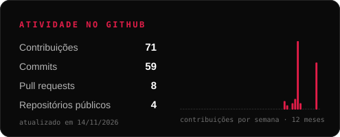
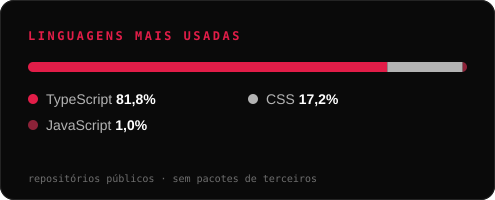

 

 

## Sobre

Venho do marketing de performance. Gerencio campanhas de Meta Ads e Google Ads para negócios locais e percebi que boa parte dos resultados se perdia **depois do clique**: páginas que não qualificam, leads sem origem, contatos que somem.

Por isso passei a construir a parte técnica do funil. Hoje desenvolvo sites e fluxos de captação em **Next.js, TypeScript e Supabase**, com rastreamento de campanha, qualificação em etapas e LGPD, e conduzo esse desenvolvimento **com agentes de IA**: escrevo a pesquisa e a especificação, o agente implementa, e eu valido com auditoria.

<table>
<tr>
<td width="33%" valign="top">

**Marketing e growth**

Meta Ads e Google Ads para negócios locais · funis anúncio → WhatsApp → oportunidade · atribuição com UTM e click IDs

</td>
<td width="33%" valign="top">

**Tecnologia**

Sites e landing pages em Next.js · Server Actions · Postgres com Row Level Security · validação com Zod · SEO técnico

</td>
<td width="33%" valign="top">

**IA no processo**

Claude Code para implementar · Claude Design para prototipar · Antigravity para auditar · especificações escritas para agentes

</td>
</tr>
</table>

---

## Projetos em destaque

<table>
<tr>
<td width="50%" valign="top">

### [biel-strategy](https://github.com/Gabriel-serra-eng/biel-strategy)
`em produção` · **[bielstrategy.com](https://bielstrategy.com)**

Site profissional que funciona como canal de aquisição. Formulário de pré-diagnóstico em 8 etapas que grava cada lead no Supabase com origem de campanha (`utm_*`, `gclid`, `fbclid`) e consentimento LGPD. A chave pública só consegue inserir, nunca ler, por RLS.

`Next.js 16` `TypeScript` `Supabase` `Zod` `GSAP`

</td>
<td width="50%" valign="top">

### [VYRO-web](https://github.com/Gabriel-serra-eng/VYRO-web)
`em desenvolvimento`

Site de uma agência de growth para clínicas e serviços locais. Captação com Server Action e e-mail via Resend, com fallback para WhatsApp quando o envio falha. GTM e Meta Pixel só carregam depois do consentimento.

`Next.js 15` `Tailwind 4` `Resend` `React Hook Form`

</td>
</tr>
<tr>
<td width="50%" valign="top">

### [landing-restaurante-vsl](https://github.com/Gabriel-serra-eng/landing-restaurante-vsl)
`protótipo`

Landing com VSL e formulário que escala o compromisso: perguntas leves primeiro, faturamento e orçamento depois, preço só no final. O servidor classifica o lead como Hot, Warm ou Cold e escolhe o evento de conversão.

`Next.js 16` `Tailwind 4` `Zod` `Framer Motion`

</td>
<td width="50%" valign="top">

### Case de tráfego · Cássia Beleza & Cachos
`Meta Ads` · **[ver no site](https://bielstrategy.com)**

Estruturação e gestão da campanha de Meta Ads de um salão, da segmentação aos criativos, com funil anúncio → clique → WhatsApp → oportunidade. **129 contatos iniciados pelo WhatsApp** a partir dos anúncios.

`Meta Ads` `WhatsApp` `Funil local`

</td>
</tr>
</table>

---

## IA no meu processo de desenvolvimento

Uso agentes de IA em etapas definidas, e cada etapa deixa um documento no repositório. Nenhum destes projetos chama um modelo em tempo de execução: a IA está na **construção**, não dentro do produto.

| Etapa | Ferramenta | Evidência |
|---|---|---|
| Pesquisa e fonte de verdade do conteúdo | Apoio de IA na organização | [`RESEARCH.md`](https://github.com/Gabriel-serra-eng/biel-strategy/blob/master/RESEARCH.md) |
| Protótipo visual | Claude Design | Design tokens do `biel-strategy` |
| Contrato técnico para o agente | Escrito antes do código | [`IMPLEMENTATION.md`](https://github.com/Gabriel-serra-eng/biel-strategy/blob/master/IMPLEMENTATION.md) |
| Implementação | Claude Code | 40 commits com co-autoria registrada |
| Pesquisa de arquitetura | Agente de pesquisa, com fontes citadas | [`LEAD_SYSTEM_RESEARCH.md`](https://github.com/Gabriel-serra-eng/biel-strategy/blob/master/LEAD_SYSTEM_RESEARCH.md) |
| Auditoria do que foi implementado | Antigravity | [`SITE_PROJECT_CONTEXT_ANTIGRAVITY.md`](https://github.com/Gabriel-serra-eng/biel-strategy/blob/master/SITE_PROJECT_CONTEXT_ANTIGRAVITY.md) |

---

## Ferramentas

<table>
<tr><td width="24%"><b>Inteligência Artificial</b></td><td>

Destacadas em vermelho: usadas no desenvolvimento dos projetos acima. As demais: uso no dia a dia, para pesquisa e copy.
</td></tr>
<tr><td><b>Desenvolvimento</b></td><td>

</td></tr>
<tr><td><b>Marketing digital</b></td><td>

-1a1a1a?style=flat-square&logo=googleanalytics&logoColor=white)

</td></tr>
<tr><td><b>Dados e infraestrutura</b></td><td>

</td></tr>
</table>

---

## Atividade

  
  

<picture>
  <source media="(prefers-color-scheme: dark)" srcset="https://raw.githubusercontent.com/Gabriel-serra-eng/Gabriel-serra-eng/output/snake-dark.svg" />
  <source media="(prefers-color-scheme: light)" srcset="https://raw.githubusercontent.com/Gabriel-serra-eng/Gabriel-serra-eng/output/snake-light.svg" />
  
</picture>

---

**Quer conversar sobre um projeto ou uma vaga?**

